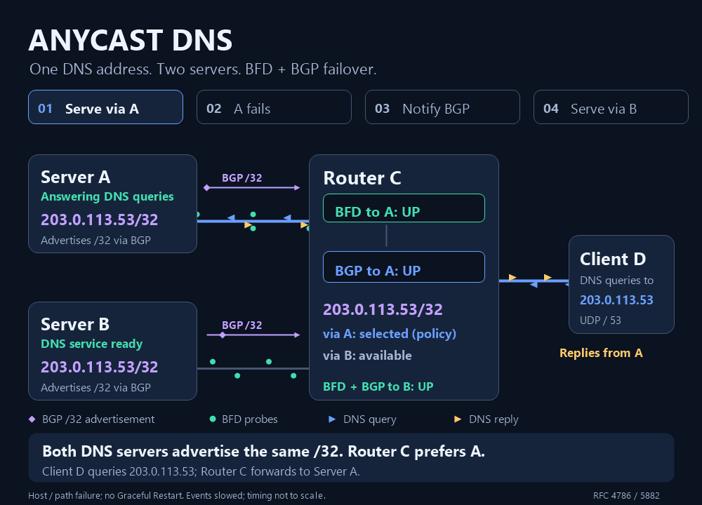

# BFD Windows service

Cowabunga, Windows network crew. Run one IPv4 or IPv6 Bidirectional Forwarding
Detection (BFD) session, or a stateless Seamless BFD (S-BFD) reflector for
multiple initiators, as a Windows service. Optional Border Gateway Protocol
(BGP) control starts and stops one configured Windows BGP peer as BFD state
changes.

The packet engine runs as LocalService in `BfdWinService`. The separate
LocalSystem service, `BfdBgpBroker`, manages BGP through authenticated local
RPC. See [service communication](docs/service-communication.md) for the
architecture.

## How BFD helps

BFD uses frequent, lightweight probes to detect failures in the forwarding
path between two systems. It can detect
failures in less than a second, including failures that leave the network
interface up. This lets routing protocols react sooner than their own failure
timers, reducing the time traffic follows an unusable path.

When integrated with BGP, BFD can trigger a peer session shutdown so BGP
removes the affected routes and selects an available
alternative. In this anycast DNS example, Server A and Server B advertise the
same address, `203.0.113.53/32`. After Server A becomes unreachable, Router C
redirects Client D's DNS queries to Server B without changing the DNS address:

## Before you begin

You need:

- 64-bit Windows 10 or later, or Windows Server 2016 or later, on x64.
- The offline setup bundle and matching SHA-256 file from
  [GitHub Releases](https://github.com/miketheitguy/bfd-winservice/releases).
- **PowerShell as Administrator** for installation and configuration.
- A local IP address, its interface index, and a configurable remote BFD peer.
  Check the [network requirements](docs/protocol.md) on both ends.

## Quick start

Follow the [setup guide](docs/setup.md) in order:

1. [Install the offline setup bundle](docs/setup.md#install-with-the-offline-setup-bundle).
   It provisions the runtime, services, security settings, and firewall rules,
   leaving the services stopped for configuration.
2. [Configure the session](docs/setup.md#2-configure-the-session).
   Set the local address, peer address, and interface index for the default
   single-hop session. Configure matching authentication when required.
3. [Start the service](docs/setup.md#4-start-the-service) and
   [verify peer communication](docs/setup.md#6-verify-peer-communication).
   Windows `Running` confirms startup; event 102 records BFD reaching `Up`.

For BGP integration, follow [Control a Windows BGP peer](docs/bgp.md). For
probes without a discriminator handshake, use
[Configure Seamless BFD](docs/seamless.md).

## Documentation

Choose a guide for your next task:

| Task | Guide |
| --- | --- |
| Look up registry settings, defaults, and key administration | [Configuration reference](docs/configuration.md) |
| Query service status, inspect versions, and troubleshoot events | [Monitoring](docs/monitoring.md) and [logs](docs/logging.md) |
| Review security and trust boundaries | [Security overview](docs/security.md) |
| Review the latest service performance measurements for version 6.0.0 and later | [Performance](docs/performance.md) |
| Build, test, or release changes | [Contributor guide](CONTRIBUTING.md) |
| Find architecture references and release notes | [Documentation index](docs/README.md) |
