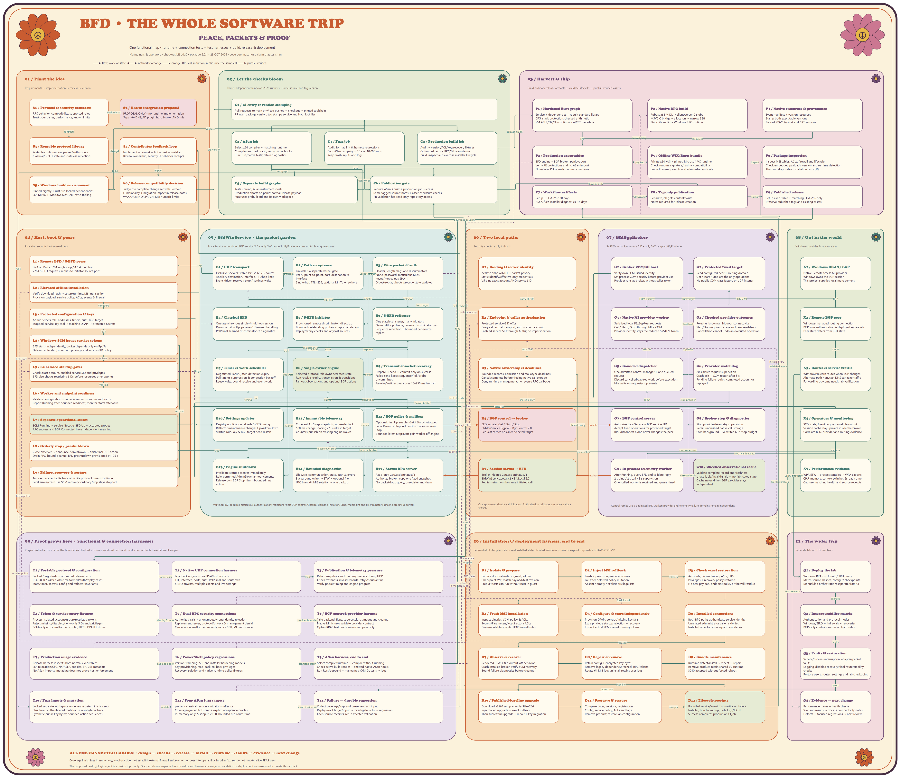

# BFD: the whole software trip

For maintainers and operators, this single diagram maps the implemented functionality, connection tests, test harnesses, and release/deployment lifecycle. It uses a 1960s flower-power palette, native editable shapes, and Cooper Black lettering.

Open [the editable diagram](bfd-flower-power-lifecycle.drawio) and zoom into a garden. The [SVG](bfd-flower-power-lifecycle.drawio.svg) scales without losing text detail; the [PNG](bfd-flower-power-lifecycle.drawio.png) is a poster preview.

Solid arrows show work, state, or lifecycle flow. Two-headed network arrows show exchanges. Orange RPC arrows show who initiates a call; replies use that call. Purple dashed arrows mean “verifies.” Node IDs connect the visual map to the text below.

Source scope: inspected checkout `bf3bda0`, package `6.0.1`, October 23, 2026, including local documentation. The health/plugin architecture is a proposal and has no implemented runtime path. Creating this map did not run product tests or change installed services.

Coverage limits: fuzz targets use in-memory APIs; loopback checks do not establish external firewall enforcement or peer interoperability. Installer fixtures use disposable hosts and do not mutate live RRAS peers. The Windows/BIRD interoperability and WPR/WPA flow is separate lab work, not a checked-in all-in-one CI harness.

The functional outline and complete connection list below provide the diagram content as text.

## 01 / Plant the idea

Requirements → implementation → review → version.

- **S1: Protocol & security contracts.** RFC behavior, compatibility, supported roles. Trust boundaries, performance, known limits.
- **S2: Health integration proposal.** PROPOSAL ONLY • no runtime implementation. Separate DNS/AD plugin host; broker AND rule.
- **S3: Reusable protocol library.** Portable configuration, packet/auth codecs. Classical/S-BFD state and stateless reflection.
- **S4: Contributor feedback loop.** Implement → format → lint → test → rustdoc. Review ownership, security & behavior receipts.
- **S5: Windows build environment.** Pinned nightly + rust-src; locked dependencies. x64 MSVC + Windows SDK; .NET/WiX tooling.
- **S6: Release compatibility decision.** Judge the complete change set with SemVer. Functionality + migration impact in release notes. vMAJOR.MINOR.PATCH; MSI numeric limits.

## 02 / Let the checks bloom

Three independent windows-2025 runners • same source and tag version.

- **C1: CI entry & version stamping.** Pull requests to main or v* tag pushes → checkout → pinned toolchain. PR uses package version; tag stamps service and both lockfiles.
- **C2: ASan job.** Select x64 compiler + matching runtime. Compile sanitized graph; verify native hooks. Run Rust/native tests; retain diagnostics.
- **C3: Fuzz job.** Audit, format, lint & harness regressions. Four ASan campaigns: 15 s or 10,000 runs. Keep crash inputs and logs.
- **C4: Production build job.** Audit + version/ACL/key/recovery fixtures. Optimized tests + RPC/MI coexistence. Build, inspect and exercise installer lifecycle.
- **C5: Separate build graphs.** Tests unwind; ASan instruments tests. Production aborts on panic; normal release payload. Fuzz uses prebuilt std and its own workspace.
- **C6: Publication gate.** Require ASan + fuzz + production job success. Same tagged source; notes + asset checksum checks. PR validation has read-only repository access.

## 03 / Harvest & ship

Build ordinary release artifacts → validate lifecycle → publish verified assets.

- **P1: Hardened Rust graph.** Service + dependencies + rebuilt standard library. CFG, stack protection, checked arithmetic. x64 ASLR/NX/EH-continuation/CET metadata.
- **P2: Native RPC build.** Robust x64 MIDL → client/server C stubs. MSVC C bridge + allocators + narrow SEH. Static library links Windows RPC runtime.
- **P3: Native resources & provenance.** Event manifest + version resources. Stamp both executable versions. Record MSVC toolset and CRT versions.
- **P4: Production executables.** BFD engine + BGP broker, panic=abort. Verify PE protections and no ASan import. No release PDBs; match numeric versions.
- **P5: Offline WiX/Burn bundle.** Private x64 MSI + pinned Microsoft VC runtime. Check runtime signature/hash + compatibility. Embed binaries, events and administration tools.
- **P6: Package inspection.** Inspect MSI tables, ACLs, firewall and lifecycle. Check embedded payloads, version and runtime detection. Then run disposable installation tests [10].
- **P7: Workflow artifacts.** Setup + SHA-256: 30 days. ASan, fuzz, installer diagnostics: 14 days.
- **P8: Tag-only publication.** Separate job gets contents:write. Notes required for release creation.
- **P9: Published release.** Setup executable + matching SHA-256 only. Preserve published tags and existing assets.

## 04 / Host, boot & peers

Provision security before readiness.

- **L1: Remote BFD / S-BFD peers.** IPv4 or IPv6 • 3784 single-hop / 4784 multihop. 7784 S-BFD requests; replies to initiator source port.
- **L2: Elevated offline installation.** Verify download hash → setup/runtime/MSI transaction. Provision payload, service policy, ACLs, events & firewall.
- **L3: Protected configuration & keys.** Admin selects role, addresses, timers, auth, BGP target. Stopped-service key tool → machine DPAPI → protected Secrets.
- **L4: Windows SCM issues service tokens.** BFD starts independently; broker depends only on RpcSs. Delayed auto start; minimum privilege and service-SID policy.
- **L5: Fail-closed startup gates.** Check exact account, enabled service SID and privileges. BFD also checks restricting SIDs before resources or endpoints.
- **L6: Worker and endpoint readiness.** Validate configuration → initial observer → secure endpoints. Report Running after bounded readiness; monitor starts afterward.
- **L7: Separate operational states.** SCM Running = service lifecycle; BFD Up = accepted probes. RPC success and BGP Connected have independent meaning.
- **L8: Orderly stop / preshutdown.** Close observer → announce AdminDown → finish final BGP action. Drain RPC; bound cleanup; BFD preshutdown provisioned at 125 s.
- **L9: Failure, recovery & restart.** Transient socket faults back off while protocol timers continue. Fatal errors/crash use SCM recovery; ordinary Stop stays stopped.

## 05 / BfdWinService • the packet garden

LocalService + restricted BFD service SID • only SeChangeNotifyPrivilege • one mutable engine owner.

- **B1: UDP transport.** Exclusive sockets; stable 49152–65535 source. Ancillary destination, interface, TTL/hop limit. Event-driven receive / stop / settings waits.
- **B2: Path acceptance.** Firewall is a separate kernel gate. Peer / point-to-point, port, destination & interface. Single-hop TTL=255; optional MinTtl elsewhere.
- **B3: Wire packet & auth.** Header, length, flags and discriminators. None, password, meticulous MD5, keyed/meticulous SHA-1. Digest/replay checks precede state updates.
- **B4: Classical BFD.** One asynchronous single-/multihop session. Down → Init → Up; passive & Demand handling. Poll/Final, learned discriminator & diagnostics.
- **B5: S-BFD initiator.** Provisioned remote discriminator; direct Up. Bounded outstanding probes + reply correlation. Replay/expiry checks and anycast sources.
- **B6: S-BFD reflector.** One stateless listener, many initiators. Demand/loop checks; reverse discriminator pair. Sequence reflection + bounded per-source replies.
- **B7: Timer & work scheduler.** Negotiated TX/RX, jitter, detection expiry. Poll timing, suppression & congestion backoff. Reuse waits; bound receive and event work.
- **B8: Single-owner engine.** Selected protocol role owns accepted state. Run receive, expiry, transmission & transitions. Fan out observations and optional BGP actions.
- **B9: Transmit & socket recovery.** Prepare → send → commit only on success. Failed send keeps sequence/Poll/probe uncommitted. Receive/wait recovery uses 10–250 ms backoff.
- **B10: Settings updates.** Registry notification reloads S-BFD timing. Reflector maintenance changes Up/AdminDown. Startup role, key & BGP target need restart.
- **B11: Immutable telemetry.** Coherent ArcSwap snapshots; no reader lock. 100 ms change spacing / 1 s refresh target. Counters publish on existing engine wakes.
- **B12: BGP policy & mailbox.** Optional; first Up enables Get / Start-if-stopped. Later Down → Stop; AdminDown releases own Stop. Bounded latest Stop/Start pair; worker off engine.
- **B13: Engine shutdown.** Invalidate status observer immediately. Role-permitted AdminDown announcements. Release own BGP Stop; finish bounded final action.
- **B14: Bounded diagnostics.** Lifecycle, communication, state, auth & errors. Background writer → ETW + optional file. UTC lines; 64 MiB rotation + one backup.
- **B15: Status RPC server.** Read-only GetSessionStatusV1. Authorize broker; copy one fixed snapshot. No packet-loop query; unregister and drain.

## 06 / Two local paths

Security checks apply to both.

- **R1: Binding & server identity.** ncalrpc only; WINNT + packet privacy. Static Identify/effective-only credentials. V5 pins exact account AND service SID.
- **R2: Endpoint & caller authorization.** Protected service-SID ACLs. Every call: actual transport/auth + exact account. Enabled service SID through Authz; no impersonation.
- **R3: Native ownership & deadlines.** Bounded records, admission and real async deadlines. Cancel/complete before freeing native call storage. Deny runtime management; no reverse RPC callbacks.
- **R4: BGP control → broker.** BFD initiates Get / Start / Stop. BfdWinService.Bgp.v2 • BgpControl 2.0. Request carries no caller-selected target.
- **R5: Session status → BFD.** Broker initiates GetSessionStatusV1. BfdWinService.Local.v2 • BfdLocal 2.0. Replies return on the same initiated call.

## 07 / BfdBgpBroker

SYSTEM + broker service SID • only SeChangeNotifyPrivilege.

- **G1: Broker COM/MI host.** Verify own SCM-issued identity. Set process COM security before provider use. Provider runs as broker, without caller token.
- **G2: Protected fixed target.** Read configured peer + routing domain. Get / Start / Stop are the only operations. No public COM class factory or UDP listener.
- **G3: Native MI provider worker.** Serialized local PS_BgpPeer requests. Get / Start / Stop through MI + COM. Provider identity stays the reduced SYSTEM token.
- **G4: Checked provider outcomes.** Reject unknown/ambiguous connectivity. Start/Stop require success and peer read-back. Cancellation cannot undo an executed operation.
- **G5: Bounded dispatcher.** One admitted control manager + one queued request. Discard cancelled/expired work before execution. Idle waits on request/stop events.
- **G6: Provider watchdog.** 20 s active request supervision. Crash exit → SCM restart after 5 s. Pending failure retries; completed action not replayed.
- **G7: BGP control server.** Authorize LocalService + BFD service SID. Accept fixed operations for protected target. RPC disconnect alone never changes the peer.
- **G8: Broker stop & diagnostics.** Stop provider/telemetry supervision. Retain unfinished native call storage. Own background ETW writer; 60 s stop budget.
- **G9: In-process telemetry worker.** After Running, query BFD and validate reply. 2 s bind / 2 s call / 8 s supervision. One stalled worker is retained and quarantined.
- **G10: Checked observational cache.** Validate complete record and freshness. Unavailable/invalid/stale → no fabricated state. Cache never drives BGP; provider stays independent.

## 08 / Out in the world

Windows provider & observation.

- **X1: Windows RRAS / BGP.** Native RemoteAccess MI provider. Windows owns the BGP session. This project supplies local management.
- **X2: Remote BGP peer.** Windows-managed routing connection. BGP wire authentication is deployed separately. Peer state differs from BFD state.
- **X3: Routes & service traffic.** Withdraw/relearn routes when BGP changes. Alternate path / anycast DNS can take traffic. Forwarding outcome needs lab verification.
- **X4: Operators & monitoring.** SCM state, Event Log, optional file output. Session cache stays private inside the broker. Correlate BFD, provider and routing evidence.
- **X5: Performance evidence.** WPR ETW + process samples → WPA exports. CPU, memory, context switches & ready time. Capture matching health and source receipts.

## 09 / Proof grows here • functional & connection harnesses

Purple dashed arrows name the boundaries checked • fixtures, sanitized tests and production artifacts have different scopes.

- **T1: Portable protocol & configuration.** Locked Cargo tests + optimized release tests. RFC 5880 / 7419 / 7880; malformed/auth/replay cases. State/timer, secrets, config and reflector invariants.
- **T2: Native UDP connection harness.** Loopback engine + real IPv4/IPv6 sockets. TTL, interface, ports, auth, Poll/Final and shutdown. S-BFD anycast, multiple clients and live settings.
- **T3: Publication & telemetry pressure.** Retain snapshots and run busy readers during UDP. Check freshness, invalid records, retry & quarantine. Verify packet timing and engine progress.
- **T4: Token & service-entry fixtures.** Process-isolated account/group/restricted tokens. Reject missing/disabled/deny-only SIDs and privileges. SCM-only entry, malformed config, HKCU DPAPI fixtures.
- **T5: Dual RPC security connections.** Authorized calls + anonymous/wrong identity rejection. Replacement server, protocol/privacy & management denial. Cancellation, malformed records, native SEH, MI coexistence.
- **T6: BGP control/provider harness.** Fake backend: flaps, supersession, timeout and cleanup. Native MI fixtures validate provider contract. Opt-in RRAS test reads an existing peer only.
- **T7: Production image evidence.** Release harness inspects both normal executables. x64 relocation/CFG/NX/ASLR, cookies, EH/CET metadata. No ASan imports; metadata does not prove host enforcement.
- **T8: PowerShell policy regressions.** Version stamping, ACL and installer hardening models. Key provisioning/read-back, rollback privileges. Recovery isolation and native-runtime policy fixtures.
- **T9: ASan harness, end to end.** Select compiler/runtime → compile without running. Check active build receipt + emitted native ASan hooks. Run Rust/deps/std + maintained C/MIDL tests → logs.
- **T10: Fuzz inputs & mutation.** Locked separate workspace → generate deterministic seeds. Structured authenticated mutation + raw-byte fallback. Synthetic public key bytes; bounded action sequences.
- **T11: Four ASan fuzz targets.** packet • classical session • initiator • reflector. Coverage-guided libFuzzer + explicit acceptance oracles. In-memory only; 5 s/input, 2 GiB, bounded run count/time.
- **T12: Failure → durable regression.** Collect coverage/logs and preserve crash input. Replay exact target/input → investigate → fix → regression. Keep source receipts; rerun affected validation.

## 10 / Installation & deployment harness, end to end

Sequential CI lifecycle suites • real installed state • hosted Windows runner or explicit disposable BFD-WS2025 VM.

- **D1: Isolate & prepare.** Enforce disposable-host guard; admin. Checkpoint VM; match payload/test revision. Prebuilt tests can run without Rust in guest.
- **D2: Inject MSI rollback.** Fresh + preexisting-service fixtures. Fail after deferred policy mutation. Absent / empty / explicit privilege lists.
- **D3: Check exact restoration.** Accounts, dependencies, ACLs, SIDs. Privileges + recovery policy restored. No new payload, endpoint policy or firewall residue.
- **D4: Fresh MSI installation.** Inspect binaries, SCM policy & ACLs. Secrets/Parameters/log directory ACLs. Five executable-specific UDP firewall rules.
- **D5: Configure & start independently.** Provision DPAPI; corrupt/missing key fails. Extra privilege startup rejection + recovery. Inspect actual SCM-issued running tokens.
- **D6: Installed connections.** Both RPC paths authenticate service identity. Unrelated administrator caller is denied. Installed reflector source-port boundaries.
- **D7: Observe & recover.** Rendered ETW + file-output-off behavior. Crash installed broker; verify SCM recovery. Bound failure diagnostics before cleanup.
- **D8: Repair & remove.** Retain config + encrypted key bytes. Remove legacy dependency; recheck RPC/tokens. Rotate 64 MiB log; uninstall retains user logs.
- **D9: Bundle maintenance.** Runtime detect/install → repeat → repair. Remove product; retain shared VC runtime. 3010 accepted without forced reboot.
- **D10: Published-baseline upgrade.** Download v2.0.0 setup + verify SHA-256. Inject failed upgrade → exact rollback. Then successful upgrade + repair + key migration.
- **D11: Preserve & restore.** Compare bytes, versions, registration. Config, service policy, ACLs and logs. Remove product; restore lab configuration.
- **D12: Lifecycle receipts.** Bounded service/event diagnostics on failure. Installer, bundle and upgrade logs/JSON. Success completes production CI job.

## 11 / The wider trip

Separate lab work & feedback.

- **Q1: Deploy the lab.** Windows RRAS + Ubuntu/BIRD peers. Match source, hashes, config & checkpoints. Manual/lab orchestration; separate from CI.
- **Q2: Interoperability matrix.** Authentication and protocol modes. Windows/BIRD withdrawals + recoveries. BGP-only controls; routes on both sides.
- **Q3: Faults & restoration.** Service/process interruption; adapter/packet faults. Logging-disabled recovery; final route/stability checks. Restore peers, routes, settings and lab checkpoint.
- **Q4: Evidence → next change.** Performance traces + health checks. Scenario results → docs & compatibility notes. Defects → focused regressions → next review.

## Connections

| From | To | Relationship |
| --- | --- | --- |
| S2 | S1 | design input |
| S1 | S3 | contracts |
| S3 | S4 | change |
| S4 | S5 | build |
| S4 | S6 | impact |
| S5 | C1 | validate |
| S6 | C1 | tag version |
| C1 | C2 | Next stage |
| C1 | C3 | Next stage |
| C1 | C4 | Next stage |
| C2 | C5 | test graph |
| C3 | C5 | fuzz graph |
| C2 | C6 | pass |
| C3 | C6 | pass |
| C4 | P1 | release graph |
| P2 | P4 | native library |
| P3 | P4 | resources |
| P1 | P4 | link |
| P4 | P5 | payload |
| P5 | P6 | inspect |
| P6 | D1 | exercise lifecycle |
| D12 | P7 | validated assets |
| D12 | C6 | build job pass |
| P7 | P8 | download |
| C6 | P8 | allow publish |
| P8 | P9 | publish |
| P9 | L2 | download & verify |
| L2 | L3 | configure |
| L3 | L4 | start |
| L4 | L5 | tokens |
| L5 | L6 | verified |
| L6 | B8 | run |
| L6 | G1 | broker ready |
| L7 | X4 | interpret |
| L8 | B13 | stop |
| L9 | L4 | recover |
| L3 | B10 | settings |
| L3 | G2 | fixed target |
| L1 | B1 | UDP |
| B1 | B2 | datagram |
| B2 | B3 | validated path |
| B3 | B4 | classical |
| B3 | B5 | initiator |
| B3 | B6 | reflector |
| B4 | B8 | state |
| B5 | B8 | state |
| B6 | B8 | response |
| B7 | B8 | due work |
| B8 | B9 | send |
| B9 | B1 | datagram |
| B10 | B7 | timing |
| B10 | B6 | maintenance |
| B8 | B11 | publish |
| B8 | B12 | transitions |
| B8 | B14 | events |
| B8 | B13 | cleanup |
| B11 | B15 | immutable view |
| B13 | B12 | release own Stop |
| B12 | R4 | RPC initiation: ncalrpc |
| R4 | G7 | RPC initiation: initiate |
| G9 | R5 | RPC initiation: ncalrpc |
| R5 | B15 | RPC initiation: initiate |
| G9 | G10 | checked reply |
| R1 | R2 | authenticate |
| R2 | R3 | authorize |
| R3 | R4 | shared policy |
| R3 | R5 | shared policy |
| G1 | G3 | COM security |
| G2 | G3 | fixed target |
| G7 | G5 | admit |
| G5 | G3 | execute |
| G3 | G4 | read back |
| G6 | G3 | supervise |
| G6 | L9 | recover broker |
| G8 | G9 | stop supervisor |
| G8 | G5 | stop provider |
| G3 | X1 | COM / MI |
| X1 | X2 | BGP |
| X2 | X3 | routes |
| B14 | X4 | diagnostics |
| G9 | X4 | RPC health events |
| X4 | X5 | capture |
| X3 | Q1 | verify externally |
| Q1 | Q2 | exercise |
| Q2 | Q3 | faults |
| Q3 | Q4 | record |
| X5 | Q4 | measurements |
| Q4 | T12 | regressions |
| T1 | T2 | native tests |
| T2 | T3 | load |
| T4 | T5 | identity fixtures |
| T5 | T6 | provider boundary |
| T7 | T8 | package policy |
| T8 | T9 | sanitized graph |
| T10 | T11 | mutate |
| T11 | T12 | crash / evidence |
| T12 | S4 | fix & recheck |
| T1 | B4 | Verifies: RFC/state |
| T2 | B1 | Verifies: UDP/path |
| T3 | B11 | Verifies: publication |
| T4 | L5 | Verifies: token policy |
| T5 | R2 | Verifies: RPC gates |
| T6 | G3 | Verifies: provider contract |
| T7 | P4 | Verifies: PE metadata |
| T8 | L2 | Verifies: installer policy |
| T9 | P2 | Verifies: native memory |
| T11 | B3 | Verifies: in-memory APIs |
| C2 | T9 | runs |
| C3 | T10 | runs |
| C4 | T1 | runs |
| D1 | D2 | Next stage |
| D2 | D3 | rollback |
| D3 | D4 | fresh install |
| D4 | D5 | Next stage |
| D5 | D6 | Next stage |
| D6 | D7 | recovery |
| D7 | D8 | Next stage |
| D8 | D9 | Next stage |
| D9 | D10 | baseline |
| D10 | D11 | Next stage |
| D11 | D12 | receipts |
| D5 | L5 | Verifies: installed token |
| D6 | R2 | Verifies: installed RPC |
| D8 | B14 | Verifies: rotation |

## Sources and regeneration

Behavior was cross-checked against the implementation and the repository guides for [communication](../../docs/service-communication.md), [protocol](../../docs/protocol.md), [S-BFD](../../docs/seamless.md), [BGP](../../docs/bgp.md), [configuration](../../docs/configuration.md), [local RPC](../../docs/security/local-rpc.md), [build hardening](../../docs/security/build-hardening.md), [fuzzing](../../docs/security/fuzzing.md), [validation](../../docs/development/validation.md), [packaging](../../docs/development/packaging.md), [performance](../../docs/performance.md), and a separate local health integration proposal (design context only). CI sequencing comes from the checked-in workflow; installed checks come from the PowerShell lifecycle harnesses.

Run `node artifacts/bfd-flower-power-lifecycle/build-diagram.cjs` from the repository root to regenerate the diagram, content data, and this text. Then run `render-diagram.ps1` in this directory. It routes connectors without moving components, exports an embedded SVG and a PNG preview below the large-canvas raster limit, and embeds the title font once in the SVG. Retain the editable source.
