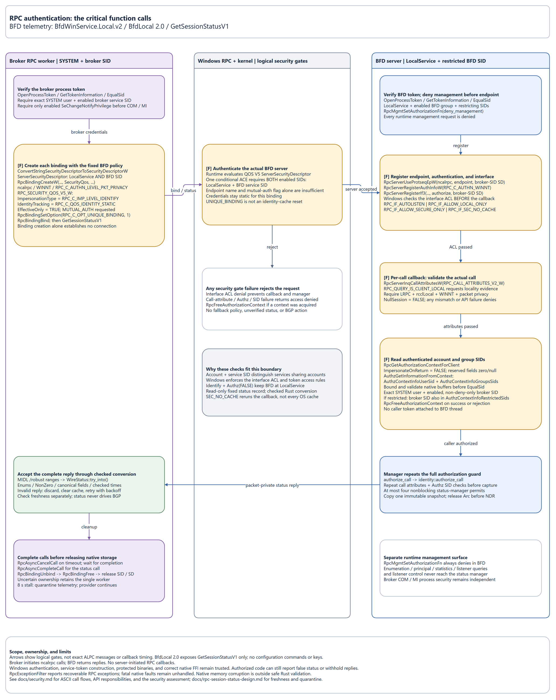
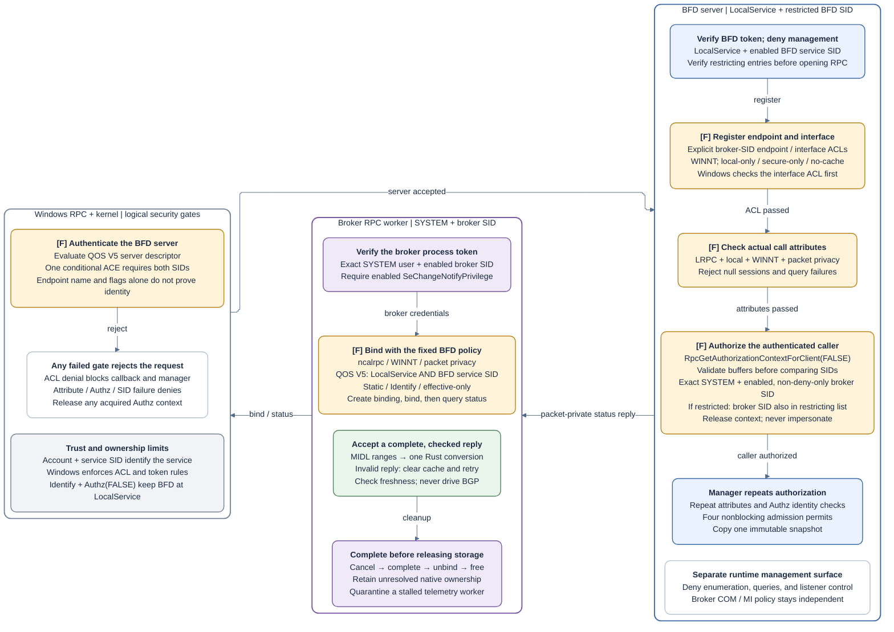

# Local RPC authentication and authorization

Cowabunga, identity crew. Check the account and service together. This guide
explains the trust gates between BFD and the BGP broker. For native API settings,
ASCII call flows, and resource ownership, use [Local RPC security](security/local-rpc.md).
For the process topology, see [Service communication](service-communication.md).

## BGP control over local RPC

Both private interfaces use Windows local RPC (`ncalrpc`, called LRPC in native
constants), WINNT packet privacy, and shared service-specific authorization.
Deploy both executables from the same build, dude.

| Caller → server | Endpoint / interface | Operation |
| --- | --- | --- |
| Broker → BFD | `BfdWinService.Local.v2` / `BfdLocal 2.0` | Read-only `GetSessionStatusV1` |
| BFD → broker | `BfdWinService.Bgp.v2` / `BgpControl 2.0` | Fixed-target `Get`, `Start`, `Stop` |

Arrows show call initiation. Replies return on the same calls; neither interface
defines server-initiated RPC callbacks. A familiar endpoint name doesn't pass
the identity vibe check. Both account and service SID must match.

Each protected discretionary access control list (DACL) and identity guard
applies these requirements:

| Gate | Broker querying BFD telemetry | BFD controlling BGP |
| --- | --- | --- |
| Expected server | LocalService and BFD service SID | LocalSystem and broker service SID |
| Interface DACL | Broker service SID | BFD service SID |
| Exact caller user | LocalSystem | LocalService |
| Enabled, non-deny-only caller group | Broker service SID | BFD service SID |
| Restricted caller check | Also require broker SID in any nonempty restricting list | Also require BFD SID in any nonempty restricting list |

Authenticated users, local administrators, and domain administrators have no
direct access to either private interface. Neither DACL grants access to
Authenticated Users, Administrators, or the service account alone. Each caller
must satisfy both the exact account and enabled service-SID checks in the table.
Remote callers are rejected regardless of their credentials or administrator
membership. Host administrators remain trusted because they can reconfigure or
replace the services; RPC authorization does not contain a compromised host
administrator.

## Interface and process boundaries

The telemetry worker runs inside the existing broker process. Status queries
copy an immutable snapshot; they carry no configuration commands or keys and
never drive BGP actions. The BFD packet engine independently requests BGP
actions through the broker's bounded control queue. The broker invokes the
Windows provider for its protected configured target.

The diagram follows the telemetry direction. BGP control uses the same gates
with the identities reversed, including the restricted-caller check in the table.

## RPC authentication flow

The PNG and Mermaid diagrams mirror the authentication page in the
[draw.io source](service-communication.drawio). Use the PNG version in GitHub
mobile and select the image to open it at full size. Both versions group checks
by the broker client, Windows RPC, and BFD server. Blue represents BFD, purple
represents the broker, amber marks security gates, green marks checked replies,
and gray represents Windows.

### Authentication diagram (PNG)

### Authentication diagram (Mermaid)

### Authentication diagram scope

For the matching ASCII diagrams, API responsibilities, and security assessment, see
[private local RPC authentication](security/local-rpc.md#broker-authenticates-bfd-telemetry).

The Windows RPC group represents runtime and kernel checks, not an additional
service process. Windows obtains identities from native tokens. The protocol
does not accept caller-supplied SIDs, process IDs, roles, passwords, or identity
metadata as authentication evidence.

## Implementation and verification

Use these references for implementation details and checks:

| Topic | Reference |
| --- | --- |
| Accounts, privileges, ACLs, and COM/MI policy | [Service isolation](security/service-isolation.md) |
| Fixed server identity policy, interface ACLs, and per-call Authz checks without impersonation | [Local RPC security](security/local-rpc.md#binding-and-server-setup) |
| Status fields, checked conversion, freshness, and native cancellation ownership | [RPC status contract](rpc-session-status-design.md) |
| BGP dispatch and provider cleanup budgets | [BGP provider](reference/bgp-provider.md) |
| Native rejection, recovery, and installed-token tests | [RPC verification](security/local-rpc.md#verify-the-implementation) |
| Installed-host authentication events | [Monitoring](monitoring.md#verify-broker-to-bfd-authentication) |
