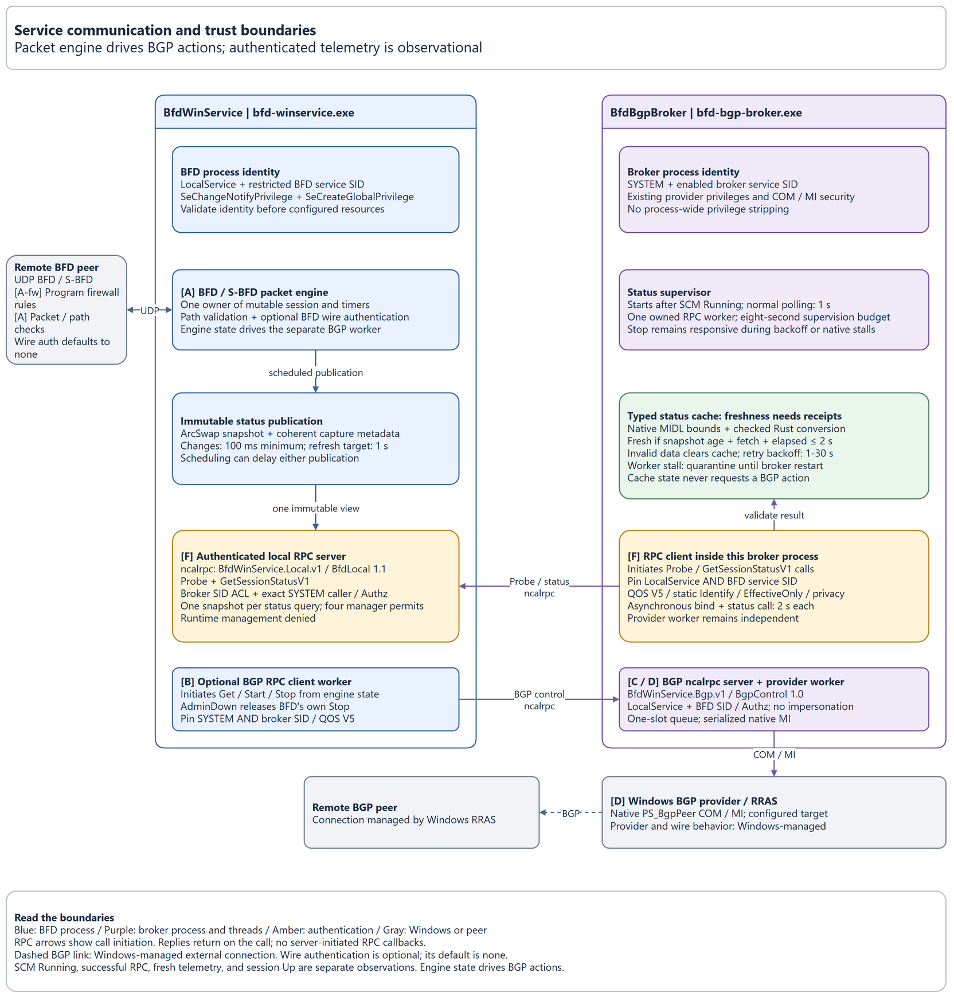
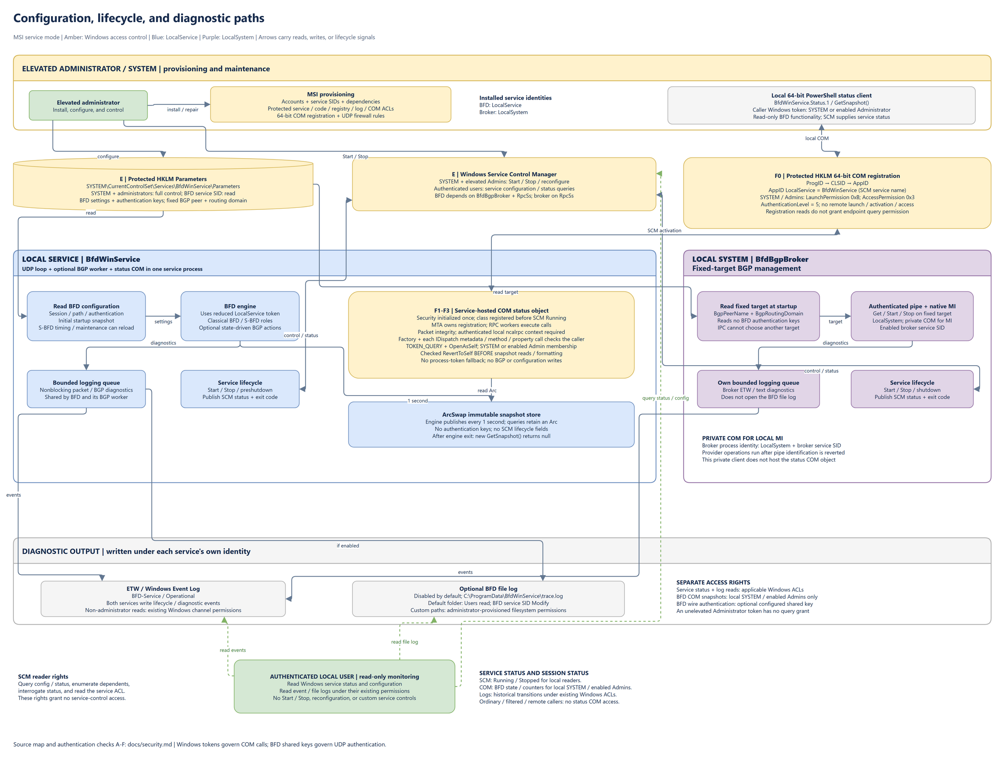

# Security, authentication, and build hardening

For Windows administrators and developers, this page explains which identities
can access the installed services, how each communication boundary checks them,
and how the compiler and linker reduce exploit opportunities. It describes the
MSI installation. For socket endpoints and BGP actions, see
[Service communication](service-communication.md).

The network-facing BFD process runs as LocalService. A separate LocalSystem
broker performs privileged BGP management for one configured target. Windows
access-control lists (ACLs) govern service control, configuration, and logs;
optional BFD wire authentication checks remote packets. These checks use
different credentials and protect different boundaries.

## Identities and privileges

A security identifier (SID) identifies a Windows account or group. The installer
enables each service SID with type `UNRESTRICTED`, so the SID participates in ACL
checks. This setting does not grant administrator rights or make LocalService
a standard interactive user.

The installed services and local callers have these permissions:

| Identity | Permissions and limits |
| --- | --- |
| `BfdWinService`: LocalService with `NT SERVICE\BfdWinService` SID | Receives and sends BFD packets, reads Parameters, writes its configured logs, and requests fixed-target BGP actions through the private pipe. Removes all token privileges except `SeChangeNotifyPrivilege` and `SeCreateGlobalPrivilege` before accepting network traffic. |
| `BfdBgpBroker`: LocalSystem with `NT SERVICE\BfdBgpBroker` SID | Owns the pipe and invokes the local Windows BGP management provider. Startup requires both LocalSystem and the enabled broker service SID. |
| Elevated Administrators and SYSTEM | Can install, start, stop, and reconfigure either service, query the local read-only COM session endpoint, modify installed files and Parameters, and manage permissions. Membership in Administrators alone does not satisfy the broker pipe's BFD client identity checks. |
| Authenticated non-administrator local users | Can query service configuration/status, enumerate dependents, interrogate the service, and read its service ACL. Can read event/file logs under the applicable Windows permissions. Cannot start, stop, reconfigure, or send custom controls to either installed service. |
| Remote network peers | Can send UDP traffic through the configured firewall rules. Packets must pass protocol/path validation and any configured BFD authentication before affecting the session. No remote broker pipe or status COM access. |

The BFD process permanently removes unused token privileges, including
`SeImpersonatePrivilege` and `SeAssignPrimaryTokenPrivilege`. The retained
privileges support directory traversal and global object creation; they do not
grant BGP management access. Access to the broker comes from its pipe ACL and
service identity checks.

Foreground `--console` execution uses the launching account and removes unused
privileges. It provides no BGP control. Removing token privileges does not remove
account or group memberships: an elevated console process still has the
launching administrator's identity. The LocalService boundary applies to the
MSI-installed service.

## Communication diagrams

The editable [draw.io diagram](service-communication.drawio) contains two pages.
The PNG exports embed editable XML so they can also be opened in draw.io. Open
each image at full size to read its labels. The equivalent ASCII diagrams and
the authentication sections provide the same boundaries in text. The exports
illustrate packet processing and BGP control; the administrative status COM
boundary is described in [Administrative COM status access](#administrative-com-status-access).

### Runtime and security

This diagram separates the network-facing LocalService process from the
LocalSystem broker and Windows management provider:



`-->` means a request or data flow. Vertical `^` / `|` / `v` arrows show requests
and responses or packets in both directions. Letters A-E identify the checks
explained in [Authentication and authorization](#authentication-and-authorization).
Background threads keep their process identity:

```text
EXTERNAL NETWORK / UNTRUSTED
[Remote BFD / S-BFD peer]
          ^
          | UDP probes/replies
          v
+--------------------------------------------------------------------------------+
| LOCAL SERVICE: BfdWinService / bfd-winservice.exe                              |
| Identity: LocalService + NT SERVICE\BfdWinService                              |
| Retains: SeChangeNotifyPrivilege, SeCreateGlobalPrivilege                      |
|                                                                                |
|   [UDP transport]                                                              |
|         | RX                                                                   |
|         v                                                                      |
|   [A: path checks + optional BFD auth]                                         |
|         | accepted packet                                                      |
|         v                                                                      |
|   [Session / timers / S-BFD reflector] --> [Published immutable snapshots]     |
|         |     |                                                                |
|         |     +----> encode + configured auth ----> UDP TX                     |
|         |                                                                      |
|         +----> [BGP worker: optional; bounded action queue]                    |
|                             |                                                  |
|                    [B: verify broker PID through SCM]                          |
+--------------------------------------------------------------------------------+
                             ^
                             | Get / Start / Stop; status/error reply
                             | \\.\pipe\BfdWinService.Bgp.v1
                             v
+--------------------------------------------------------------------------------+
| LOCAL SYSTEM: BfdBgpBroker / bfd-bgp-broker.exe                                |
| Identity: LocalSystem + NT SERVICE\BfdBgpBroker                                |
|                                                                                |
|   [C: startup identity check + pipe ACL + per-request client check]            |
|         | identification ends; RevertToSelf before provider work               |
|         v                                                                      |
|   [Validate 24-byte frame; operation allowlist; next sequence number]          |
|         |                                                                      |
|   [Fixed BGP target loaded from protected registry at startup]                 |
|         |                                                                      |
|   [Native MI client: Get / Start / Stop]                                       |
+--------------------------------------------------------------------------------+
                             ^
                             | Local MI; broker's LocalSystem identity
                             v
+--------------------------------------------------------------------------------+
| WINDOWS MANAGEMENT PROVIDER / OS-MANAGED PRIVILEGE BOUNDARY                    |
|   [D: provider access under broker identity; scoped IMPERSONATE]               |
|   root/Microsoft/Windows/RemoteAccess : PS_BgpPeer                             |
|                             |                                                  |
|                         [RRAS / BGP]                                           |
+--------------------------------------------------------------------------------+
                             ^
                             | OS-managed BGP connection (outside this repo)
                             v
                       [Remote BGP peer]
```

Packet validation and authentication run before accepted traffic can change
session state or refresh detection. Detection timeouts also change state and
can cause BGP actions. The service publishes immutable session snapshots for
its local read-only administrative COM endpoint. COM calls execute separately
from the packet loop and read the published snapshot.

### Configuration, lifecycle, and logs

This diagram separates administrative writes and service control from
non-administrator monitoring:



The text diagram shows the administrative and diagnostic paths:

```text
ELEVATED ADMINISTRATOR / SYSTEM
  |
  +-- [E: registry ACL] --> HKLM\SYSTEM\CurrentControlSet\Services\
  |                         BfdWinService\Parameters
  |                         |
  |                         +-- read --> BFD: session settings + auth keys
  |                         +-- read --> Broker: BGP peer name + routing domain
  |
  +-- [E: SCM access] ----> Start / Stop / lifecycle for both services
  |                         BFD depends on BfdBgpBroker
  |                         Broker depends on RpcSs
  |
  +-- MSI provisioning --> service accounts/SIDs, protected service ACLs,
                            executable/registry/log ACLs, UDP firewall rules

OUTPUT UNDER EACH SERVICE'S OWN IDENTITY
  BfdWinService -- bounded logging queue --> ETW / BFD-Service/Operational
                  +-----------------------> optional configured file log
  BfdBgpBroker -- bounded logging queue ---> ETW / BFD-Service/Operational
  Both services --------------------------> SCM status / exit codes

AUTHENTICATED LOCAL USER / READ-ONLY MONITORING
  +-- [E: SCM query rights] --> Running / Stopped and service configuration
  |                             No Start/Stop or custom control rights
  +-- [Windows log ACLs] ----> read Operational events and file logs
```

## Authentication and authorization

Authentication establishes who sent a packet or request. Authorization determines
which actions that identity can perform. Windows uses account/service tokens for
local access; BFD wire authentication uses an optional shared secret. Neither
the pipe sequence number nor UDP source/TTL checks replace an identity check.

### A: Remote BFD and S-BFD packets

The UDP transport validates the source and destination, ports, interface, and
time to live (TTL)/hop limit for the configured role. Packet/session code validates
BFD structure and discriminators before accepting peer state. See
[UDP inputs and outputs](service-communication.md#udp-inputs-and-outputs) for
the role-specific rules. These path checks alone do not authenticate the peer.

`Auth` defaults to `none`. When enabled, both peers must use the same
authentication type, key ID, and secret. The receiver checks the authentication
section and compares the password or computed keyed digest using constant-time
equality. Authentication failures do not refresh detection or update accepted
session state. The sender adds the configured authentication to outgoing packets.

The supported modes provide these checks:

| `Auth` setting | Check and limitations |
| --- | --- |
| `none` | Protocol/path validation only. Traffic that passes those checks can influence the session and its configured BGP actions without a shared-key check. |
| `simple-password` | Verifies the key ID and matching password. The password travels in cleartext; this mode has no authentication sequence protection. |
| `keyed-md5`, `keyed-sha1` | Verifies the key ID and the RFC-defined digest of the packet with the configured key. Classical BFD enforces a receive sequence window but permits repeated sequences within the protocol rules. |
| `meticulous-md5`, `meticulous-sha1` | Uses the corresponding keyed digest and classical receive window, and rejects repeated sequences. |

The keyed modes follow BFD's MD5/SHA-1 packet format; they are not HMAC or
encryption. BFD authentication does not hide packet contents. A valid shared-key
check establishes possession of the configured secret, rather than a distinct
Windows or certificate identity for each peer.

S-BFD initiators require keyed replies to match an unconsumed, unexpired
outstanding probe. Reflectors verify the configured authentication and copy a
keyed request's sequence into the response without maintaining a per-peer receive
window. These behaviors differ from a classical BFD session's replay checks.

Configure exactly one of `AuthKey` (ASCII) and `AuthKeyHex` (binary key encoded as
hexadecimal) when authentication is enabled. Password/MD5 keys are 1-16 bytes;
SHA-1 keys are 1-20 bytes. `AuthKeyId` is 0-255. One key is active at a time;
restart after changing authentication settings. Keys are stored in Parameters
under its protected ACL, without application-level encryption. Logs and
configuration errors omit key values. See
[Configure authentication](configuration.md#authentication) for the settings
and an example.

### B: BFD authenticates the broker

Before exchanging messages on `\\.\pipe\BfdWinService.Bgp.v1`, the BFD client calls
`GetNamedPipeServerProcessId`. It queries the Service Control Manager (SCM) for
the running `BfdBgpBroker` service and requires the Windows-reported pipe server
PID to match the SCM process ID. It does not trust a PID supplied in a message.
This rejects a process that claims the pipe name without being the running broker.

The client requests individual data read/write rights, rather than generic write
rights that also permit pipe-instance creation. It opens the pipe with
`SECURITY_SQOS_PRESENT | SECURITY_IDENTIFICATION`, allowing identity inspection.
See Microsoft's [named-pipe access rights](https://learn.microsoft.com/en-us/windows/win32/ipc/named-pipe-security-and-access-rights).

### C: Broker authenticates and authorizes BFD requests

The broker checks its own process token at startup for LocalSystem and the enabled
`NT SERVICE\BfdBgpBroker` SID. It creates a single pipe instance with an explicit,
protected ACL: the BFD service SID gets data read/write access, and the broker
SID gets full access. The BFD client cannot create server instances or change
the ACL. `PIPE_REJECT_REMOTE_CLIENTS` rejects remote connections;
`FILE_FLAG_FIRST_PIPE_INSTANCE` makes startup fail if another process already
owns the pipe name.

For every request, the broker calls `ImpersonateNamedPipeClient` to obtain the
client's identification token. It opens that token for `TOKEN_QUERY` with
`OpenAsSelf`, then uses `CheckTokenMembership` to require both enabled
`NT SERVICE\BfdWinService` and LocalService SIDs. Unrelated LocalService processes
and ordinary administrator clients fail these checks. The broker calls
`RevertToSelf` before provider work; failed reversion aborts the process.

Identification exposes the caller's identity for checking. It does not grant
permission to open files, registry keys, or provider objects as that caller.
See Microsoft's [impersonation levels](https://learn.microsoft.com/en-us/windows/win32/secauthz/impersonation-levels).

After identification, the broker validates the fixed 24-byte frame, protocol
version, operation allowlist (`Get`, `Start`, `Stop`), and next connection sequence
number. Replies carry status/error information. This sequence check orders the
local protocol; the Windows token and ACL establish caller identity.

The broker independently reads only the BGP peer name and routing domain from
protected Parameters at startup. Requests cannot specify a peer, routing domain,
command, path, or registry key. The broker uses its own LocalSystem authority
only for that fixed target. This is the service's BGP action policy, not an
interactive administrator credential passed through the BFD process.

### D: Broker accesses the local Windows provider

Native Management Infrastructure (MI) calls target the local
`root/Microsoft/Windows/RemoteAccess` namespace and `PS_BgpPeer` class. The
destination explicitly requests `IMPERSONATE`, so the Windows provider can
access resources under the broker's LocalSystem identity. Pipe identification
has already ended. Windows governs provider authorization; the application
supplies no separate provider password or remote MI destination.

The broker's private Component Object Model (COM) initialization supports native
MI. Its process security descriptor admits only local SYSTEM and Administrators.
It explicitly sets `RPC_C_AUTHN_LEVEL_PKT_INTEGRITY` and an outgoing default of
`IDENTIFY`. Packet integrity protects against message tampering without encrypting
the payload. See Microsoft's [COM authentication levels](https://learn.microsoft.com/en-us/windows/win32/com/authentication-level).

The broker sets `EOAC_DISABLE_AAA | EOAC_NO_CUSTOM_MARSHAL` to prevent
activate-as-activator launches under its privileged identity and restrict custom
marshaling. The MI destination's explicit `IMPERSONATE` setting is scoped to
provider calls. See Microsoft's [COM security capabilities](https://learn.microsoft.com/en-us/windows/win32/api/objidl/ne-objidl-eole_authentication_capabilities).

Windows Routing and Remote Access Service (RRAS) manages the final BGP connection
to the remote BGP peer. This repository invokes its local provider and does not
configure BGP wire
authentication. Provider permissions and RRAS process identity depend on the
host's Windows configuration.

### E: Service control, configuration, and diagnostic access

Windows checks the caller's access token against each object's ACL. There is no
application login or shared password for `Start-Service`, `Stop-Service`, registry
edits, or log reads. Use an elevated administrator token for service control and
configuration changes; SYSTEM retains full control.

The MSI provisions protected permissions for these objects:

| Object | Write/control access | Read/query access |
| --- | --- | --- |
| Both SCM service objects | SYSTEM and Administrators have full control, including Start/Stop and configuration changes. | Authenticated Users have query-config, query-status, enumerate-dependents, interrogate, and read-control rights (`0x2008d`). No Start/Stop, reconfiguration, or custom controls. |
| Installed executables, manifest, logging script, and installation directory | SYSTEM and Administrators have full control. | Users and the BFD service SID have read/execute access. |
| `HKLM\SYSTEM\CurrentControlSet\Services\BfdWinService\Parameters` | SYSTEM and Administrators have full control. | BFD service SID has read access; the LocalSystem broker reads its BGP target. Ordinary users cannot read authentication keys. |
| Status COM registration under 64-bit `HKLM\SOFTWARE\Classes` | SYSTEM and Administrators have full control over protected keys. | Users and LocalService can read activation metadata; this does not grant endpoint access. |
| `BfdWinService.Status.1` COM endpoint | Provides read-only observations; no configuration or BGP mutation methods. | Local SYSTEM and tokens with the enabled Administrators SID only. Unelevated Administrator tokens and remote callers are denied. |
| Default file-log directory | SYSTEM and Administrators have full control; BFD service SID has Modify access. | Users retain read access. Custom log paths use their provisioned filesystem ACLs. |
| `BFD-Service/Operational` event channel | Windows Event Log permissions govern event publication and channel management. | The manifest supplies no custom channel access ACL; existing Windows log-read permissions remain in effect. |

The BFD service reads its configuration at startup. S-BFD timing and reflector
maintenance settings can reload through registry notifications, with polling
as a fallback. The broker's fixed target requires a restart to reload.

BFD writes Operational events through Event Tracing for Windows (ETW) and an
optional file log through a bounded logging queue. The broker writes Operational
events through its own queue and does not open the BFD file log. Both services
report lifecycle status and exit codes to
SCM. A service-status query reports Running/Stopped and process lifecycle, rather
than the BFD session's Up/Down state. See
[Monitor service status and BFD events](monitoring.md) and
[Logs and events](logging.md).

### Administrative COM status access

`BfdWinService.Status.1` exposes `GetSnapshot()` through standard COM Automation
(`IDispatch`) inside the LocalService BFD service process. The AppID's
`LocalService` registry value names the SCM service `BfdWinService`; there is no
alternate executable, DLL surrogate, or privileged status broker. See Microsoft's
[LocalService COM registration](https://learn.microsoft.com/en-us/windows/win32/com/localservice).

The MSI installs an explicit binary `LaunchPermission` descriptor granting only
SYSTEM and Administrators `COM_RIGHTS_EXECUTE | COM_RIGHTS_EXECUTE_LOCAL |
COM_RIGHTS_ACTIVATE_LOCAL` (`0xb`). Its `AccessPermission` grants those same
principals `COM_RIGHTS_EXECUTE | COM_RIGHTS_EXECUTE_LOCAL` (`0x3`). Neither
descriptor grants remote launch, activation, or calls. The five activation
registry roots have protected ACLs so ordinary users cannot alter the policy.
See Microsoft's [DCOM permission masks](https://learn.microsoft.com/en-us/windows/win32/com/dcom-security-enhancements-in-windows-xp-service-pack-2-and-windows-server-2003-service-pack-1).

The process initializes COM security with an explicit local SYSTEM/Administrators
descriptor, packet integrity, identification-level callers, and
`EOAC_DISABLE_AAA | EOAC_NO_CUSTOM_MARSHAL`. Initialization failure closes the
endpoint. Class creation and dispatch calls check local RPC provenance and the
caller's enabled SYSTEM or Administrators SID. UAC's filtered Administrator
token does not satisfy the Administrators check. Caller identification ends
before reading the snapshot; no query performs work using the caller's token.

Status reads clone an immutable `Arc` from an ArcSwap observer and never acquire
a lock held by the BFD loop. The engine refreshes the snapshot at most once per
second, so it can describe older protocol state. State telemetry contains no
authentication keys or packet payloads. Engine shutdown makes subsequent reads
unavailable; already-returned objects retain their historical values until the
COM connection closes. For PowerShell access and field meanings, see
[Query a session snapshot](monitoring.md#query-a-session-snapshot).

## Rust compiler and linker hardening

The settings in [Cargo.toml](../Cargo.toml) and
[.cargo/config.toml](../.cargo/config.toml) apply to both executables. The build
targets `x86_64-pc-windows-msvc` and rejects other Windows architectures.
[rust-toolchain.toml](../rust-toolchain.toml) pins the nightly compiler and includes
`rust-src` for rebuilding the standard library.

Compiler instrumentation and executable metadata make certain attacks harder
or terminate the process when checks fail. They do not replace authentication,
ACLs, or correct handling of untrusted packets.

### Rust compiler options

The compiler and Cargo profiles provide these protections:

| Setting | Security benefit and scope |
| --- | --- |
| `-C control-flow-guard=yes` | Inserts checks on indirect calls and emits valid-call-target metadata. Together with `/GUARD:CF`, lets Windows reject invalid call targets caused by corrupted function pointers. See [Rust CFG options](https://doc.rust-lang.org/rustc/codegen-options/index.html#control-flow-guard). |
| `-C relocation-model=pic` | Generates position-independent code suitable for relocation, supporting randomized load addresses. ASLR also needs linker metadata and Windows support. See [Rust relocation models](https://doc.rust-lang.org/rustc/codegen-options/index.html#relocation-model). |
| `-Z stack-protector=all` | Requests stack canaries in all functions and checks them on return to detect stack corruption. This is Rust's compiler instrumentation; MSVC's `/GS` is a C/C++ compiler option. Canaries detect some corruption, not every memory error. See [Rust stack protector](https://doc.rust-lang.org/unstable-book/compiler-flags/stack-protector.html). |
| `-Z ehcont-guard=yes` | Emits valid exception continuation targets for the linker. With `/GUARD:EHCONT`, supports Windows validation of resumed instruction pointers. See [EH continuation metadata](https://learn.microsoft.com/en-us/cpp/build/reference/guard-enable-eh-continuation-metadata?view=msvc-170). |
| `overflow-checks = true` in development and release | Makes overflowing ordinary integer arithmetic panic instead of silently wrapping. Explicit `wrapping_*`, `saturating_*`, and `checked_*` operations retain their intended behavior. See [Cargo overflow checks](https://doc.rust-lang.org/cargo/reference/profiles.html#overflow-checks). |
| `panic = "abort"` in production release | Immediately terminates on a panic rather than unwinding through the process. Destructors, BGP cleanup, and normal service-stop logging do not run on this path. Normal handled errors still use `Result` and cleanup. See [Cargo panic strategy](https://doc.rust-lang.org/cargo/reference/profiles.html#panic). |

`stack-protector` and `ehcont-guard` use nightly Rust. Cargo's
[`build-std`](https://doc.rust-lang.org/cargo/reference/unstable.html#build-std)
configuration rebuilds `std` and `panic_unwind` with target flags, extending
instrumentation to the service, its Rust dependencies, and the target standard
library. Windows system DLLs retain their own build settings. The explicit target
keeps host build scripts and procedural macros on default host settings.

### MSVC linker options

Rust passes these options through `-C link-arg=...` to the MSVC linker:

| Option | Security benefit and scope |
| --- | --- |
| `/MACHINE:X64` | Selects the supported 64-bit executable architecture. This enables the x64 mitigation configuration; architecture selection alone is not an access control. |
| [`/DYNAMICBASE`](https://learn.microsoft.com/en-us/cpp/build/reference/dynamicbase-use-address-space-layout-randomization?view=msvc-170) | Marks the image for address space layout randomization (ASLR), making useful code/data locations less predictable. |
| [`/HIGHENTROPYVA`](https://learn.microsoft.com/en-us/cpp/build/reference/highentropyva?view=msvc-170) | Enables high-entropy 64-bit ASLR, increasing the address space available for randomization. Requires `/DYNAMICBASE` and `/LARGEADDRESSAWARE`. |
| [`/LARGEADDRESSAWARE`](https://learn.microsoft.com/en-us/cpp/build/reference/largeaddressaware-handle-large-addresses?view=msvc-170) | Lets the image use addresses above 2 GB and supports high-entropy ASLR. It is not a memory-safety check. |
| [`/NXCOMPAT`](https://learn.microsoft.com/en-us/cpp/build/reference/nxcompat-compatible-with-data-execution-prevention?view=msvc-170) | Declares compatibility with Data Execution Prevention (DEP/NX), which prevents execution from pages marked as data. Does not prevent corruption or reuse of existing executable code. |
| [`/GUARD:CF`](https://learn.microsoft.com/en-us/cpp/build/reference/guard-enable-guard-checks?view=msvc-170) | Includes CFG image flags and valid-call-target tables. Works with Rust's CFG instrumentation; the linker switch alone does not add call-site checks. |
| [`/GUARD:EHCONT`](https://learn.microsoft.com/en-us/cpp/build/reference/guard-enable-eh-continuation-metadata?view=msvc-170) | Links EH continuation metadata for Windows instruction-pointer validation during context restoration. An enabled empty table is valid when the image has no continuation targets. |
| [`/CETCOMPAT`](https://learn.microsoft.com/en-us/cpp/build/reference/cetcompat?view=msvc-170) | Marks compatibility with Control-flow Enforcement Technology (CET) shadow stacks, which protect return addresses against return-oriented attacks. Actual enforcement requires suitable hardware, Windows support, and process mitigation policy. |

Structured Exception Handling Overwrite Protection (SEHOP) is a separate Windows
process policy. It is not enabled by these linker flags. On x64, exception
handlers use table-based metadata; `/SAFESEH` is an x86-only option. See
[Enable SEHOP for the executable](setup.md#enable-sehop-for-the-executable)
for the deployment setting.

### Diagnostics, lint policy, and security limits

AddressSanitizer (ASan) adds runtime memory-error detection to test builds. The
following settings control diagnostics and code checks:

| Setting | Benefit and limitation |
| --- | --- |
| Release `opt-level = 3` | Optimizes runtime code. Optimization is not an authentication or memory-safety mechanism. |
| Development `debug = 2`; ASan inherits development | Retains full debugging information and PDBs to investigate failures. AddressSanitizer is test instrumentation for detecting memory errors, not a production authorization check. |
| Release `debug = 0`, `strip = "symbols"`, and `/DEBUG:NONE` | Omits debug information/symbols and suppresses MSVC PDB generation, reducing distributed diagnostic metadata. Release crash dumps lack matching PDBs for source-level debugging. These settings do not make code secret or verify executable integrity. |
| `-Z src-hash-algorithm=sha256` | Uses SHA-256 source checksums when debug information is emitted, helping debuggers match source files. These are not an executable signature or runtime authentication. |
| `warnings`, `unsafe_code`, `unsafe_op_in_unsafe_fn`, `clippy::undocumented_unsafe_blocks`, and `clippy::unwrap_used` set to `deny` | Makes warnings, unapproved unsafe code, implicit unsafe operations, undocumented unsafe blocks, and production `unwrap()` calls fail the relevant checks. Narrow Windows API boundaries explicitly allow required unsafe code and still require safety explanations. |

Cargo's [profile reference](https://doc.rust-lang.org/cargo/reference/profiles.html)
describes optimization and debug settings. Rust ownership, initialization, and
bounds checks protect safe Rust code; Windows API calls still depend on correctly
reviewed unsafe boundaries. The build has no C/C++ source compilation step:
`/GS`, `/sdl`, `/analyze`, and `/Zi` are not flags passed to `rustc`.

The `test-release` alias overrides panic handling to `unwind` for the test graph.
It tests release optimizations but does not reproduce production's abort strategy.
The `asan` alias adds sanitizer instrumentation to tests, including the rebuilt
standard library, and retains the other target hardening settings.

Cargo's nightly `profile-rustflags` feature adds release-only `/DEBUG:NONE`
alongside the shared target flags, preserving development and ASan debug output.

### Verification

[tests/windows_hardening.rs](../tests/windows_hardening.rs) checks both executable
images for architecture, relocations, ASLR/NX/CFG flags, CFG tables, security-cookie
metadata, EH continuation data, CET compatibility, and profile-specific debug
output. These checks verify emitted metadata. A security-cookie address alone
does not prove every function has stack-protector instrumentation, and a CET flag
does not prove that the host enforces shadow stacks.

For build commands, sanitizer checks, compiler-output inspection, and verification
of production artifacts, see [Build security](../CONTRIBUTING.md#build-security).
Recheck those settings after changing the toolchain, profiles, or compiler/linker
overrides.

## Source map

These files define the authentication and privilege boundaries:

| Path | Relevant implementation |
| --- | --- |
| [installer/Package.wxs](../installer/Package.wxs) | Service accounts, dependencies, SCM control/query ACLs, Parameters ACL, and firewall rules |
| [src/service.rs](../src/service.rs) and [src/bgp_broker/service.rs](../src/bgp_broker/service.rs) | SCM lifecycle, startup checks, service-hosted status COM, private broker COM initialization, and conditional broker probe |
| [src/runtime/privileges.rs](../src/runtime/privileges.rs) | `RETAINED` and `drop_privileges` |
| [src/transport.rs](../src/transport.rs) | `Datagram::validate`, transport construction, `send`, and `send_reply` |
| [src/session.rs](../src/session.rs), [src/packet.rs](../src/packet.rs), and [src/seamless.rs](../src/seamless.rs) | `receive_checked`, `receive_seamless`, `AuthConfig::verify_decoded`, and `respond_checked` |
| [src/status_com.rs](../src/status_com.rs), [src/runtime/status.rs](../src/runtime/status.rs), and [src/runtime/state.rs](../src/runtime/state.rs) | Local administrative COM caller checks, immutable status publication, and the lightweight atomic state observer |
| [src/bgp_broker/com.rs](../src/bgp_broker/com.rs) | Private broker COM security for native MI |
| [src/bgp/ipc.rs](../src/bgp/ipc.rs) | `require_broker_identity`, `identify_client`, `verify_server`, frame validation, and pipe listener |
| [src/bgp.rs](../src/bgp.rs) and [src/bgp_broker.rs](../src/bgp_broker.rs) | Bounded BGP mailbox, state-to-action policy, fixed target, and request dispatch |
| [src/bgp_broker/mi.rs](../src/bgp_broker/mi.rs) | Local MI destination, impersonation option, namespace, and provider calls |
| [src/config/registry.rs](../src/config/registry.rs) | `load_registry`, `SettingsWatch`, and `load_bgp_target` |
| [src/runtime/logging.rs](../src/runtime/logging.rs) and [events/BFD-Service.man](../events/BFD-Service.man) | Diagnostic queues, ETW output, optional file logging, and event channel |
