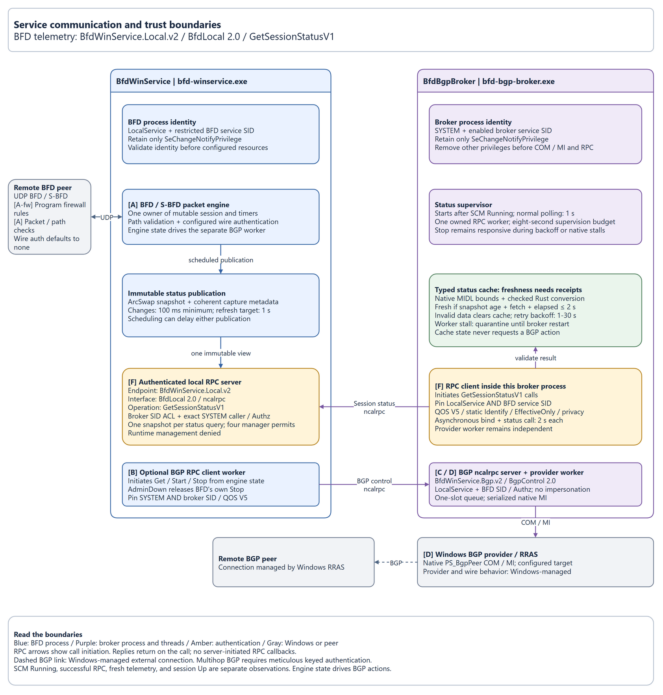
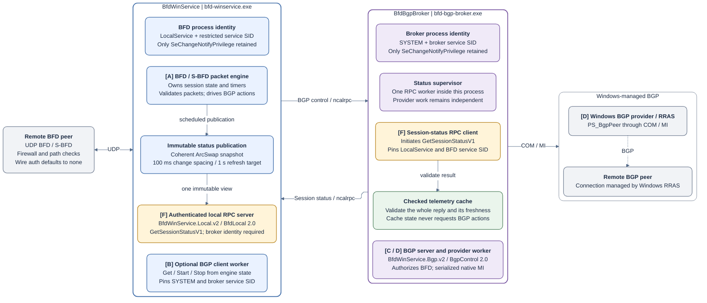
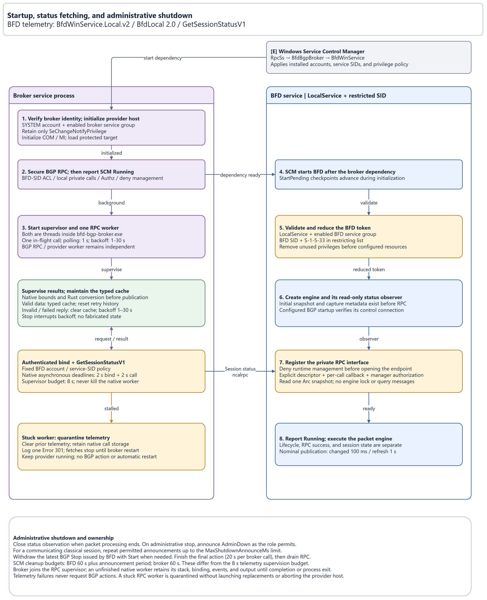
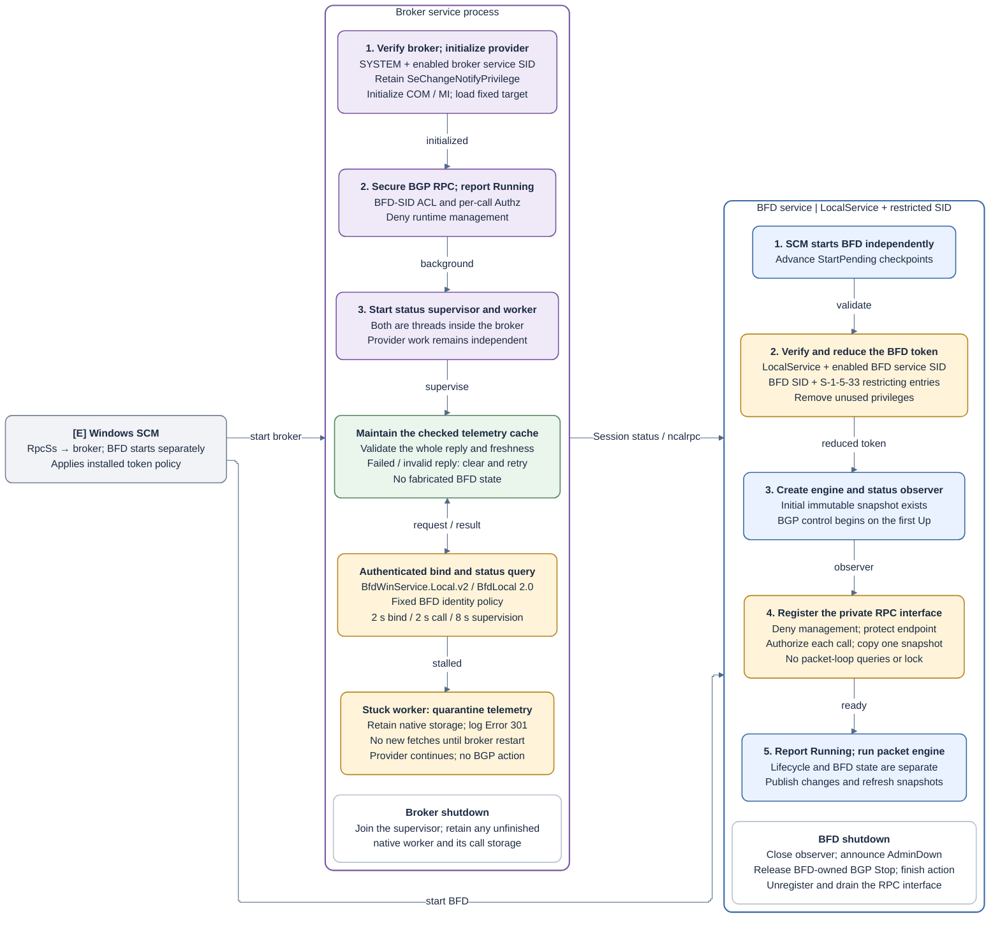

# Service communication

Cowabunga, developers and Windows admins! Let's trace the service lineup, dude.
This page maps the installed services' network endpoints, private local RPC
interfaces, and BGP actions. See
[Security, authentication, and build hardening](security.md) for identities,
permissions, and authentication boundaries.

The key receipt, no cap: the packet engine drives BGP actions. The broker's
status cache is for observation, and an SCM `Running` status doesn't mean the
session is Up.

BFD hosts an authenticated local RPC interface for the broker. The broker calls
it from a worker thread inside its existing process. BGP control uses a separate
authenticated local RPC interface; the Windows provider COM/MI API retains its
own contract.

For service identities, binding settings, and authorization, use the
[RPC authentication guide](rpc-authentication.md). Both service channels use
Windows local RPC (`ncalrpc`), with separate contracts and call initiators.

Each interface keeps call initiation in one direction, dude:

| Call initiator | RPC server | Endpoint (`ncalrpc`) | Operations |
| --- | --- | --- | --- |
| Broker's telemetry worker | BFD service | `BfdWinService.Local.v2` | `GetSessionStatusV1` |
| BFD's BGP worker | BGP broker | `BfdWinService.Bgp.v2` | `Get`, `Start`, `Stop` |

Diagram arrows show **call initiation**, from client to server. BFD returns
status replies to the broker; the broker returns control results to BFD
on their respective calls. These replies do not initiate reverse RPC calls.
Mermaid RPC arrows attach to process boundaries; the named client and server
cards identify the workers inside them.
Neither interface defines RPC callback operations, and fast bindings reject
server-initiated RPC callbacks. Local authorization callbacks only check access
inside the receiving process. See [Windows fast-binding restrictions](https://learn.microsoft.com/en-us/windows/win32/api/rpcasync/nf-rpcasync-rpcbindingbind).

The runtime and lifecycle diagrams each have separate PNG and Mermaid sections.
Use the PNG versions in GitHub mobile and select an image to open it at full size.
The [RPC authentication diagram](rpc-authentication.md#rpc-authentication-flow)
shows the client, Windows RPC, and server checks in both formats. Their matching
[editable draw.io source](service-communication.drawio) has three pages.

The `V1` in `GetSessionStatusV1` names the status-record schema; the telemetry
endpoint and RPC interface use version 2. See the
[status contract](rpc-session-status-design.md#native-interface-contract) for
the wire definition and deployment requirements.

## Runtime flow

Here's how to read the lineup, buddy: the boxes group work by process. Blue
represents BFD, purple represents the broker, amber marks authentication gates,
green marks checked telemetry, and gray represents Windows or a network peer.
RPC arrows show call initiation; responses return on the same call. The dashed
BGP link is Windows-managed. Classical multihop BGP control requires meticulous
keyed authentication.

### Runtime diagram (PNG)

### Runtime diagram (Mermaid)

### Runtime behavior

Cowabunga, runtime crew. Follow which process initiates each operation. The two
installed services roll through these paths:

1. `BfdWinService` receives and validates UDP packets and executes BFD/S-BFD
   timers as LocalService. Its mutable session has one engine owner.
2. The engine coalesces telemetry into an immutable `ArcSwap` snapshot, normally
   at most every 100 milliseconds, with a one-second unchanged refresh.
3. BFD's private `ncalrpc` interface, `BfdWinService.Local.v2`, exposes only
   `GetSessionStatusV1`. An RPC worker authorizes the broker, loads one
   snapshot, and copies a fixed record without requesting packet-loop work.
4. The broker's RPC worker runs inside `bfd-bgp-broker.exe`. It authenticates BFD
   and converts the reply into checked Rust types before publishing its cache.
   There is no helper executable instance, stdout transport, or additional pipe.
5. When `BgpPeerName` is configured, BFD's separate BGP worker sends `Get`,
   `Start`, or `Stop` on the `ncalrpc` endpoint `BfdWinService.Bgp.v2`. The client
   pins SYSTEM and the broker SID; the broker checks BFD through Authz without
   impersonation.
6. The broker invokes native Management Infrastructure (MI) against the local
   `PS_BgpPeer` provider for its configured target. Windows RRAS manages the BGP
   connection to the remote peer.

Telemetry vibe check: the status cache is, like, observational. Invalid,
unavailable, or stale telemetry does not request a BGP action or become a
fabricated BFD state. The provider worker remains independent of telemetry and
uses the broker's reduced SYSTEM token and configured COM/MI security.

## Service lifecycle

SCM starts each service independently. Only the broker depends on `RpcSs` for
native MI; neither service waits for its counterpart to report Running. The
broker's telemetry worker retries while BFD is unavailable.

### Lifecycle diagram (PNG)

### Lifecycle diagram (Mermaid)

### Startup and shutdown behavior

Keep the turtle team in formation through startup and cleanup. Either service
can start first; only `BfdBgpBroker` requires `RpcSs`. The broker
secures its BGP control RPC interface before reporting Running, then starts the
telemetry monitor and retries while BFD is unavailable. BFD gives RPC a read-only
observer before moving the engine to its packet worker. Neither SCM Running nor
RPC success implies a session is Up.

BFD closes its observer as soon as packet processing ends, before announcements
and BGP cleanup. After cleanup, it unregisters and drains its interface before
releasing the security descriptor. The broker stops its supervisor without
joining an unfinished native RPC worker. That single owned worker retains its
native call storage until completion or process exit; it is never forcibly
terminated or replaced repeatedly. A native ownership wipeout isn't an
acceptable cleanup strategy.

An administrative BFD stop repeats AdminDown announcements for a communicating
classical session's detection period, capped by `MaxShutdownAnnounceMs`. Other
roles or sessions attempt one role-permitted notification; reflectors send none.
It also withdraws the controller's own
latest BGP Stop with Start when needed, then finishes the latest queued action.
Each final broker call has a 20-second limit. BFD's SCM supervisor allows
60 seconds plus the announcement period for cleanup; the broker's stop budget
is 60 seconds. These service cleanup budgets are separate from the eight-second
RPC telemetry budget. See [BGP lifecycle and shutdown](bgp.md).

## Private local RPC status

Donatello follows the immutable snapshot from engine publication to an RPC
worker, then through checked conversion into the broker cache. Queries never
ask the packet loop for work. The [status contract](rpc-session-status-design.md)
owns fields, cadence, freshness, recovery, and native lifetimes; use
[monitoring](monitoring.md) for installed-host queries.

## UDP inputs and outputs

Match the wire path before the packet crew kicks shell. The
[protocol reference](protocol.md) owns per-role ports, source policy, and
TTL/hop-limit checks. The [installation inventory](reference/installation.md#installed-firewall-rules)
lists the executable-specific firewall rules. Packet validation and kernel
firewall filtering are separate gates.

## BGP behavior

Turtle power follows engine state and the configured control policy. BGP control
runs only when `BgpPeerName` is configured for classical BFD or an S-BFD
initiator. Reflectors reject BGP control. Plain BFD starts no BGP worker and makes
no BGP control calls. Both services start independently even with BGP configured;
functional control calls require the broker to be available.

The packet engine owns state-driven actions. Read the [BGP action rules](bgp.md#verify-state-changes-and-actions)
for startup, failure, recovery, and administrative disablement. The broker's
telemetry cache never supplies these decisions.

The final RRAS-to-remote-peer link represents Windows-managed BGP behavior.
This repository invokes the local management provider; it does not implement
the BGP connection or configure its wire authentication. The actual RRAS
process token and deployed provider/channel ACLs require host inspection.

For implementation locations, see the [security source map](security.md#source-map).
