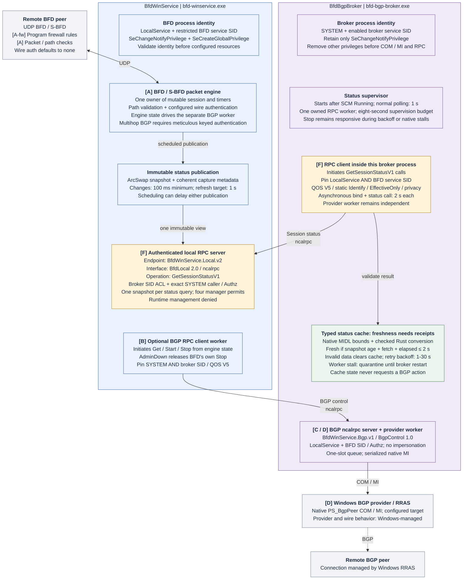
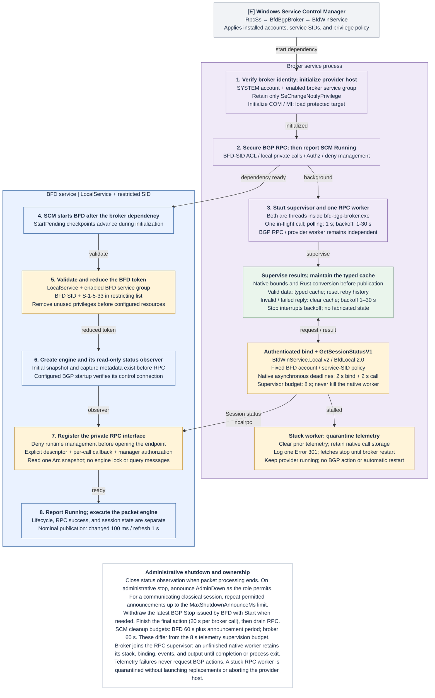

# Service communication

For developers and Windows administrators, this page maps the installed
services' network endpoints, private local RPC interfaces, and BGP actions. See
[Security, authentication, and build hardening](security.md) for identities,
permissions, and authentication boundaries.

The key receipt: the packet engine drives BGP actions. The broker's status cache
is for observation, and an SCM `Running` status doesn't mean the session is Up.

BFD hosts an authenticated local RPC interface for the broker. The broker calls
it from a worker thread inside its existing process. BGP control uses a separate
authenticated local RPC interface; the Windows provider COM/MI API retains its
own contract.

Both service channels use Windows local RPC (`ncalrpc`) with WINNT packet
privacy, mutual service-identity checks, protected service-SID ACLs, and per-call
Authz authorization. The protocol name is `ncalrpc` on both paths; LRPC is the
Windows runtime's local-RPC name, not a separate transport or weaker mode.
Neither path uses TCP or the RPC named-pipe transport.

Each interface permits calls initiated in one direction:

| Call initiator | RPC server | Endpoint (`ncalrpc`) | Operations |
| --- | --- | --- | --- |
| Broker's telemetry worker | BFD service | `BfdWinService.Local.v2` | `GetSessionStatusV1` |
| BFD's BGP worker | BGP broker | `BfdWinService.Bgp.v1` | Control liveness check, `Get`, `Start`, `Stop` |

Diagram arrows show **call initiation**, from client to server. BFD returns
status replies to the broker; the broker returns control results to BFD
on their respective calls. These replies do not initiate reverse RPC calls.
Neither interface defines RPC callback operations, and fast bindings reject
server-initiated RPC callbacks. Local authorization callbacks only check access
inside the receiving process. See [Windows fast-binding restrictions](https://learn.microsoft.com/en-us/windows/win32/api/rpcasync/nf-rpcasync-rpcbindingbind).

The runtime and lifecycle diagrams are embedded below as Mermaid. The
[RPC authentication diagram](rpc-authentication.md#rpc-authentication-flow)
shows the client, Windows RPC, and server checks. Their matching
[editable draw.io source](service-communication.drawio) has three pages.

Telemetry uses `BfdWinService.Local.v2`, `BfdLocal` version `2.0`.
The BGP control endpoint remains
`BfdWinService.Bgp.v1`, `BgpControl` version `1.0`.
The `V1` suffix in `GetSessionStatusV1` identifies the status-record schema;
the telemetry endpoint and RPC interface use version 2.

The [authentication diagram](rpc-authentication.md#rpc-authentication-flow)
names the client binding, server registration, call-attribute, Authz, SID, and
cleanup functions. For ASCII call flows and the security assessment, see
[private local RPC authentication](security/local-rpc.md#broker-authenticates-bfd-telemetry).

## Runtime flow

The boxes group work by process. Blue represents BFD, purple represents the
broker, amber marks authentication gates, green marks checked telemetry, and
gray represents Windows or a network peer. RPC arrows show call initiation;
responses return on the same call. The dashed BGP link is Windows-managed.
Classical multihop BGP control requires meticulous keyed authentication.

The two installed services use these paths:

1. `BfdWinService` receives and validates UDP packets and executes BFD/S-BFD
   timers as LocalService. Its mutable session has one engine owner.
2. The engine coalesces telemetry into an immutable `ArcSwap` snapshot, normally
   at most every 100 milliseconds, with a one-second unchanged refresh.
3. BFD's private `ncalrpc` interface, `BfdWinService.Local.v2`, exposes only
   `GetSessionStatusV1`. An RPC worker authorizes the broker, loads one
   snapshot, and copies a fixed record without requesting packet-loop work.
4. The broker's RPC worker runs inside `bfd-bgp-broker.exe`. It authenticates BFD
   and converts the reply into checked Rust types before publishing its cache.
   There is no helper executable instance, stdout transport, or additional pipe.
5. When `BgpPeerName` is configured, BFD's separate BGP worker sends `Get`,
   `Start`, or `Stop` on the `ncalrpc` endpoint `BfdWinService.Bgp.v1`. The client
   pins SYSTEM and the broker SID; the broker checks BFD through Authz without
   impersonation.
6. The broker invokes native Management Infrastructure (MI) against the local
   `PS_BgpPeer` provider for its configured target. Windows RRAS manages the BGP
   connection to the remote peer.

The status cache is observational. Invalid, unavailable, or stale telemetry does
not request a BGP action or become a fabricated BFD state. The provider worker
remains independent of telemetry and uses the broker's reduced SYSTEM token
and configured COM/MI security.

## Service lifecycle

SCM starts BFD as soon as the broker reports Running. The broker's telemetry
worker runs concurrently with BFD startup.

SCM starts `RpcSs`, then `BfdBgpBroker`, then its dependent `BfdWinService`.
The broker secures its BGP control RPC interface before reporting Running,
then starts the telemetry monitor and retries while BFD initializes. BFD gives
RPC a read-only observer before moving the engine to its packet worker. Neither SCM Running nor RPC success implies a session is Up.

BFD closes its observer as soon as packet processing ends, before announcements
and BGP cleanup. After cleanup, it unregisters and drains its interface before
releasing the security descriptor. The broker stops its
supervisor without joining an unfinished native RPC worker. That single owned
worker retains its native call storage until completion or process exit; it is
never forcibly terminated or replaced repeatedly.

An administrative BFD stop repeats AdminDown announcements for a communicating
classical session's detection period, capped by `MaxShutdownAnnounceMs`. Other
roles or sessions attempt one role-permitted notification; reflectors send none.
It also withdraws the controller's own
latest BGP Stop with Start when needed, then finishes the latest queued action.
Each final broker call has a 20-second limit. BFD's SCM supervisor allows
60 seconds plus the announcement period for cleanup; the broker's stop budget
is 60 seconds. These service cleanup budgets are separate from the eight-second
RPC telemetry budget. See [BGP lifecycle and shutdown](bgp.md).

## Private local RPC status

`src/local_rpc.rs` owns registration and the fixed BFD client identity policy.
`src/local_rpc/status.rs` owns the fixed record and conversion into Rust domain
types. `src/local_rpc/monitor.rs` owns one supervised RPC worker and the cache.
Both broker threads run inside the existing service process.

Authentication pins LocalService plus the BFD service SID on the client. BFD
requires SYSTEM plus the broker service SID on every call. Static Identify
credentials and packet privacy protect the exchange without enabling additional
privileges. Broker startup permanently removes every token privilege except
`SeChangeNotifyPrivilege` before COM/MI initialization; provider calls retain
the broker's own SYSTEM account and its existing COM/MI security policy.
The BFD token retains its existing two-entry privilege allowlist and restricted
service SID policy. See [RPC authentication](rpc-authentication.md).

Binding and the status call each have a two-second native asynchronous deadline.
The supervisor imposes an eight-second monitoring budget. A stalled worker
quarantines telemetry until broker restart. Invalid replies and transient
failures clear the cache to `Unavailable` and retry after 1, 2, 4, 8, 16, then
30 seconds; a valid reply restores one-second polling. Stop interrupts backoff.
These query failures do not kill the provider host; fatal native faults remain
outside the recoverable RPC handler.

See [RPC session-status query](rpc-session-status-design.md) for response fields,
accepted ranges, freshness, quarantine policy, and validation results. For
operator queries, see [Monitor service status and BFD events](monitoring.md).

## UDP inputs and outputs

The selected role determines the socket endpoints. `P` and `Q` denote the local
and peer stable source ports, respectively, each in 49152-65535. The port
numbers can differ. Outgoing TTL/hop limit is 255.

| Role | Outgoing packet | Incoming packet | Receive TTL/hop limit |
| --- | --- | --- | --- |
| Classical single-hop | local:P -> peer:3784 | peer:Q -> local:3784 | Exactly 255 |
| Classical multihop | local:P -> peer:4784 | peer:Q -> local:4784 | Required metadata; `MinTtl` threshold if configured |
| S-BFD initiator | local:P -> reflector:7784 | reflector:7784 -> local:P | Required metadata; `MinTtl` threshold if configured |
| S-BFD reflector | local:7784 -> initiator's source port | initiator's source port -> local:7784 | Required metadata; `MinTtl` threshold if configured |

Classical point-to-point mode identifies the peer by its configured link and
discriminator rather than requiring a fixed source IP. S-BFD uses configured
peer/allowed-source rules. The reflector's runtime accepts nonzero source ports
other than 7784; the installed firewall limits requests to 49152-65535.

## BGP behavior

BGP control runs only when `BgpPeerName` is configured for classical BFD or an
S-BFD initiator. Reflectors reject BGP control. Plain BFD still has the installed
SCM dependency on the broker, but starts no BGP worker and makes no BGP RPC connection check.

Startup reads BGP status without changing the peer. Entering Up requests Start
if needed; Down after the session has established requests Stop. Peer AdminDown
or an administrative service stop withdraws the controller's own latest Stop
with Start when needed. Crashes and RPC disconnections do not themselves stop
the BGP peer.

The final RRAS-to-remote-peer link represents Windows-managed BGP behavior.
This repository invokes the local management provider; it does not implement
the BGP connection or configure its wire authentication. The actual RRAS
process token and deployed provider/channel ACLs require host inspection.

For implementation locations, see the [security source map](security.md#source-map).
